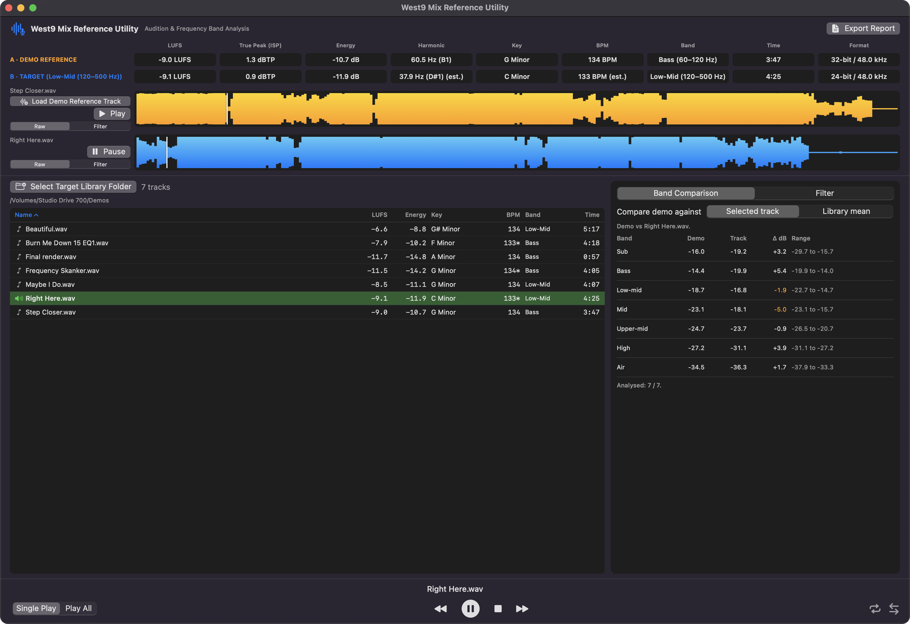
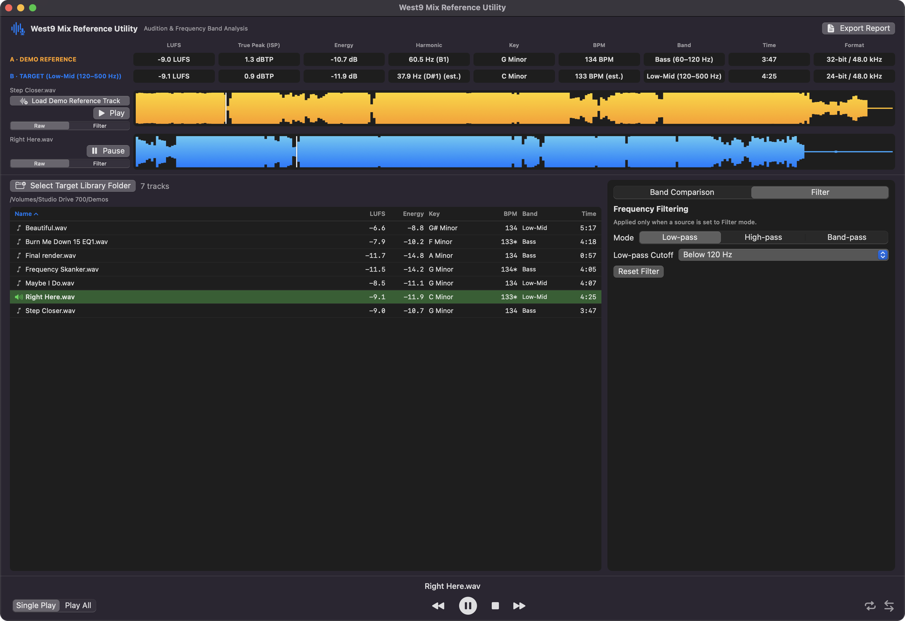
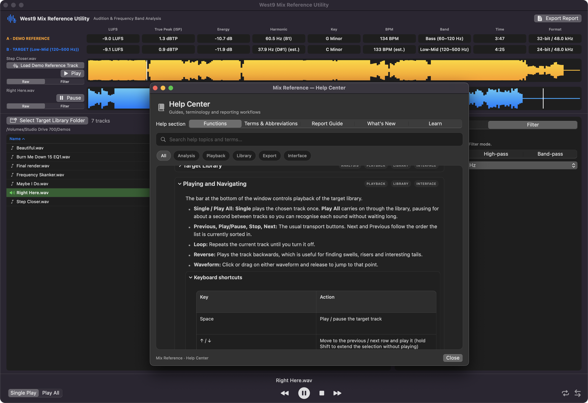

# Mix Reference

**Hear and see how your mix compares, in seconds.** Mix Reference is a free macOS app from West 9 Studios that puts your demo or work-in-progress next to a whole folder of reference tracks or samples, so you can audition them, measure them and compare them without leaving one window.

[**Download Mix Reference 1.9**](https://github.com/west9studios/Mix-Reference-Releases/releases/latest) · macOS 13 or later · 3.4 MB · Free, no account or licence key

## What it does

Load your own track as the **Demo Reference**, point the app at a folder as the **Target Library**, and step through the folder with the arrow keys. Every track you play is analysed, so the readings fill in as you audition.

- **Nine readings per track:** LUFS loudness, True Peak (ISP), Energy, Harmonic, Key, BPM, dominant Band, length and format, shown for your demo and the selected target side by side.
- **Seven-band frequency comparison:** see where your demo has more or less energy than a chosen track, or than the average of the whole library, from Sub (20-60 Hz) up to Air (12-20 kHz), with the difference in dB.
- **Low-pass, high-pass and band-pass listening:** isolate one slice of the spectrum on the demo, the target, or both, to hear exactly where two tracks differ.
- **Fast library auditioning:** arrow-key navigation plays each track as you land on it. Sort by Name, LUFS, Energy, Key, BPM, Band or Time; the Key column follows the Circle of Fifths.
- **Loop and Reverse:** keep a sample cycling while you browse, or play it backwards to find swells, risers and interesting tails.
- **Drag-and-drop export:** drag chosen files to the Desktop or into your DAW. The app copies them and never touches the originals.
- **Export Report:** save a clean, formatted report of your session as a web page, ready to read, print as a PDF or send to a client.
- **Built-in Help Center and one-click updates:** a searchable manual is included, and the app tells you when a new version is available and installs it for you.

<table>
  <tr>
    <td width="50%"></td>
    <td width="50%"></td>
  </tr>
  <tr>
    <td align="center">Listen to one slice of the spectrum</td>
    <td align="center">A searchable Help Center is built in</td>
  </tr>
</table>

## Why use it

- Stop switching between a loudness meter, a spectrum analyser and a file browser: the comparison happens in one place.
- Judge your mix against commercial references by ear and by number at the same time.
- Get through hundreds of files quickly, whether you are choosing references, building a set or curating a sample library.
- Your audio files are never modified.

## Who it's for

- **Mixing and mastering engineers** checking tonal balance and loudness against commercial masters.
- **DJs** building sets by key, tempo and loudness.
- **Producers and remixers** matching a rough demo to the sound of a genre.
- **Beat makers and sound designers** auditioning drum loops, samples and FX, including in reverse.
- **Film and game composers** comparing cues against temp tracks.

## What's new

Mix Reference 1.9 is available.

The full history is in the app under **Help > What's New**.

## Install

1. Download the DMG from the [latest release](https://github.com/west9studios/Mix-Reference-Releases/releases/latest).
2. Open it and drag **Mix Reference** into **Applications**.
3. Launch the app. If macOS blocks the first launch, open **System Settings > Privacy & Security** and choose **Open Anyway**.

Once installed, Mix Reference checks for new versions when it starts. Choose **Update & Relaunch** when the orange notice appears and the app updates itself. Each release also publishes a `.sha256` file if you want to verify your download.

Version 1.9 was released on 14 November 2026. DMG SHA-256: `3f7203e1f457052867380fbd9d05c77b626384fa87fc6b315b10b2888ecc184e`

## Licence

MIX REFERENCE — PLAIN-LANGUAGE LICENCE NOTICE

Mix Reference is free to use. It remains the property of West 9 Studios.

You may not redistribute, resell, modify, or reverse-engineer Mix Reference, or
claim it as your own. No licence key or payment is required to use the app.

Mix Reference is provided “as is”, without any warranty, express or implied.
West 9 Studios is not responsible for loss or damage arising from its use.

This is a plain-language notice, not legal advice. It does not replace any
rights or obligations that may apply under the law.
